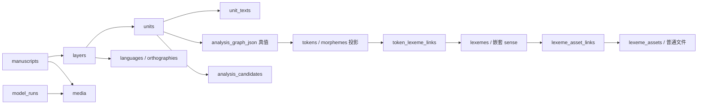

# Design — 单库领域接替
## 1. 成熟方案扫描 / Research

- [ADR 原始说明](https://cognitect.com/blog/2011/11/15/documenting-architecture-decisions)：保留背景、决定、后果；当前详细结构不与 ADR 并行维护。
- [SQLite 外键](https://www.sqlite.org/foreignkeys.html)：逐连接开启；普通外键表达真实引用，JSON 嵌套义项与多态目标必须在业务事务内核对。
- [SQLite JSON](https://www.sqlite.org/json1.html)：JSON 文本可校验语法，但不能代替现有 zod/DMLex 领域校验；不为本片引入 JSONB、ORM 或迁移框架。
- 复用现有 `saveAnnotationUnitAnalysisGraph.ts` 的图校验/基线比较、`lexemeNestedIds.ts` 的归一化、`storagePortServiceLexemeOps.ts` 的词条写入；适配为单库事务内读回。
- 外部规范只核对交换表达能力；DMLex 的仓库 schema 是词条校验输入，EAF/LIFT 不是本库 DDL，往返以语义与损失清单验收。
- 反模式：提交后才核对、以 JSON 合法代替领域合法、把文件操作称作数据库原子写、重复维护 schema.sql 和 schema.ts。现有依赖足够，无新增依赖成本。
## 2. 载体与真实入口

ADR-0088 保留决定快照。本设计是后续切片的草案，字段进入实现后只在 schema.ts 维护精确定义；规格任务全完成按 ADR-0051 删除。下表不是可直接执行的完整 DDL。

| 现有入口／模块 | 后续落位与责任 |
| --- | --- |
| `src/pages/annotation/saveAnnotationUnitAnalysisGraph.ts`、`src/db/storagePortAiAnalysisGraph.ts` | `src/db/desktop/analysis.ts`：人工、导入、候选写入共用领域提交；页面只传业务输入 |
| `src/db/storagePortServiceUnitTokenOps.ts`、`src/hooks/importExport/persistImportedTokenGraph.ts` | 接入上述提交，不能继续独立修改词项投影 |
| `src/pages/annotation/saveAnnotationLexemeLink.ts`、`src/db/storagePortServiceLexemeOps.ts` | `src/db/desktop/lexicon.ts`：词条、义项引用和附件业务 |
| `src/db/storagePortServiceOrthography.ts`、`src/services/languageCatalog/` | `src/db/desktop/catalog.ts`：项目目录、模板实例化与引用核对 |
| `src/hooks/importExport/useImportExport.ts`、`src/services/EafService.ts` | 保留纯交换转换，持久动作改接新业务入口；损失清单作为返回值 |
| `src/db/desktop/manuscripts.ts`、`units.ts`、`client.ts`（计划路径） | 时间映射、正文修改、有限同名 IPC；主进程 effect/actions，投影是 derived |
代际当前值、审计/备注、文件阶段与探针验收见[写入边界规格](../desktop-domain-write-boundaries/design.md)，不作为 M1 新前置。
## 3. 字段与约束草案
约定：行 id 为非空 TEXT 主键；必填加 NOT NULL，时间沿用项目统一编码；可选关系才可 NULL，其他可选产品值须逐列列入切片合同。JSON 明确对象/数组和空值，语法 CHECK 与服务领域校验并用；所有引用删除默认阻止，产品卸下在业务事务中显式执行。以下新增字段不进 M1。

| 表／字段组 | 类型、关系及校验责任 |
| --- | --- |
| `units.analysis_graph_json` | 可无已接受图；有值须完整图校验。正文真值仍为 `unit_texts(role=transcription)`；图 text 与正文一致性、完整映射编码见 [R1 合同草案](../annotation-graph-rebuild/design.md)。代际与指纹按 ADR-0089。 |
| `analysis_candidates` | id、unit_id→units、种类、status、graph_json、图指纹、文稿代际、语段分析代际、actor_json、created_at/updated_at。建议与待复核快照按 ADR-0089 区分。实现该片时再写入 `schema.ts`。 |
| `tokens` | id=稳定图节点 id，unit_id→units、token_index 为非负整数；form_json 对象、gloss_json 对象、pos、provenance_json 及时间；多语空值策略与 R1 一起定。 |
| `morphemes` | 同上，加 token_id→tokens、morpheme_index、surface_parts_json；token 与 morpheme 的 unit 必须相同。只投影符合 ADR-0088 的线性节点。 |
| `token_lexeme_links` | id、target_type(token/morpheme)、target_id、lexeme_id→lexemes、sense_id、role、confidence、provenance_json、时间；多态目标存在性、entry 类型和嵌套 sense 在事务内检查；confidence 有值为有限 [0,1]。 |
| `lexemes` | id、kind(entry/resource)、entry_json/resource_json、jieyu_json、tags_json、access_rights、provenance_json、时间；CHECK 保证正文互斥且对应 kind，嵌套 id 归一化后校验；resource 每项目至多一行，无 usage_count。 |
| `lexeme_assets` | id、relative_path、sha256、kind、mime_type、display_name、byte_size、language_code、ref_count、时间；保留现有附件语言能力，byte_size/ref_count 非负整数；路径越界与文件身份在主进程核对。 |
| `lexeme_asset_links` | id、lexeme_id→lexemes、asset_id→lexeme_assets、created_at；与 ref_count 同事务维护，并核对实际链接数；磁盘收尾按 R5。 |
| `manuscripts` 扩展 | logical_duration_sec 有值为有限正数；time_mapping_json 对象或无映射、time_mapping_history_json 数组最多 8 条、export_timeline_mode、tier_roles_json；scale 有限且 >0，offset 有限，sourceMediaId 匹配 media_id，revision 不倒退。 |
| `languages` | id、name_json、canonical_tag、iso6393、glottocode、autonym、scope 等现有标量；完整标量映射以 types.ts LanguageDocType 逐项核对，不因本表缩写丢弃。非空 ISO/Glottocode 唯一，空串不充当缺值。 |
| `languages` 文档列 | countries、countries_official、administrative_divisions、domains、dialects、vernaculars、writing_systems、notes、custom_fields：沿 ADR-0067 具名 JSON 文本列，不另包 profile。 |
| `language_display_names` / `language_aliases` | 独立 id、language_id→languages；保留 locale/role/value/is_preferred/source_type/review_status 与 alias/normalized_alias/alias_type 等既有字段；别名查询建索引。 |
| `language_catalog_history` | id、language_id、action、summary、changed_fields、reason/reason_code、时间；追加写，删除语言后的历史引用保留策略须目录片定稿，不能默认 CASCADE。 |
| `orthographies` | id、language_id→languages、name_json、abbreviation、type、script_tag、locale_tag、direction；其余 region/variant、目录来源、字体/输入法/规范化等按 OrthographyDocType 逐项定列或具名 JSON，不丢现有值。 |
| `orthography_bridges` | id、source/target_orthography_id→orthographies、engine、status、is_reversible、name_json、rules_json、sample_input/output、sample_cases_json、notes_json、时间；复用现有 schema 的规则枚举。 |
| `units.external_ref` / `unit_texts.external_ref` | 可无外部 id；有值不得为空字符串。语段重导入匹配 `(layer_id, external_ref)`，文稿经 layer 核对，内容行作用域还需 role；不用全库 external_ref 唯一。 |
| `model_runs` | ADR-0057 §8 除项目归属 textId 外的字段逐项 snake_case 映射；media_id→media，params_json、range_start/end、started_at/finished_at、status、error_code、chunk_count、accepted/rejected/pending_count；范围有限有序，计数非负，状态转换及时间按运行片校验。 |
| `ai_tasks` / `provenance_json` | 任务只承接有恢复需求的现有 AiTaskDoc；每种任务先核对 target 和恢复语义再定 DDL，不在此虚构通用任务表。来源复用 ProvenanceEnvelope，modelRunId 写入前核对运行归属。 |

索引草案：tokens UNIQUE(unit_id,token_index)，morphemes UNIQUE(token_id,morpheme_index)；候选按 `(unit_id,种类,status)` 查询；依 ADR-0089 不建 accepted 的一语段唯一索引；links 按 target 与 lexeme/sense 索引；附件按 lexeme_id/asset_id；目录按规范化别名；外部匹配仅对非空外部 id 建作用域索引。节点 id 仅图内唯一时须先解决跨语段主键冲突，不能未经证明直接作为全库 id。当前图仅在 units 行；历史 accepted 与当前图分开。
## 4. 关系图（逻辑关系，非完整外键清单）

## 5. 业务操作合同（方法名草案，类型就近落位）

每次调用一次主进程事务/IPC；客户端不传表名或 SQL。标注的人工编辑、导入和候选接受进入同一个提交过程：读取完整当前状态 → 核对预期版本和写入资格 → 应用操作 → 完整校验 → 同步图、词项投影及词义索引 → 事务内读回 → 提交并返回。调用方提交操作和预期版本，不提交整份快照。异常整体回滚；事件/缓存仅提交后更新。不存在的按 id 读取返回空，列表返回完整行。R1 字段合同未确认前不实现该入口。版本、曾经接受与恢复按 [ADR-0089](../../../adr/0089-analysis-generation-accept-and-restore.md)。R5 的文件协议和 R6 的逐列空值不在这个入口里定。

| 操作 | 输入与原子变化 | 返回／失败 |
| --- | --- | --- |
| `analysis.apply` | unitId、预期版本，以及补丁、带覆盖范围的导入或候选接受三者之一。主进程在完整现值上合并。导入没提供的映射和关系保留 | 当前完整分析、投影和受影响关联；版本冲突整次拒绝。R1 合同先定稿；过期与恢复按 ADR-0089 |
| `analysis.submitCandidate` | 建议内容和生成时的文稿代际、语段代际、图指纹。只保存建议，并把该语段其余待定建议改为拒绝 | 完整建议；不改当前分析，也不改待复核快照或曾经接受的记录。规则见 ADR-0089 |
| `units.updateText` | unitId、text、预期凭据；正文改变、完整旧分析快照、清图、卸下关联/投影、推进语段分析代际在同一主进程事务，共用分析内部逻辑，不拼两次 IPC | 正文、完整快照、代际与卸下清单；任一步失败整次回滚 |
| `lexicon.saveEntry` / `linkSense` / `removeSense` | 归一化嵌套 id，校验正文和扩展；核对目标、例句/出现引用以及反向词义链接 | 完整词条或链接；引用未解除拒绝，不批量猜改指向 |
| `catalog.ensureProjectDefinition` | 模板来源/裸 ISO 解析为项目行后引用；已有实例复用 | 完整项目目录行；不在层外键里混用代码 id |
| `manuscripts.setTimeMapping` / `rollbackTimeMapping` | 当前映射、预期 revision、历史同事务；不修改语段文献秒 | 完整文稿映射/历史；正文边界编辑用文献轴，播放器秒先反算 |
| `modelRuns.start` / `finish` / `acceptTranscription` | 运行行独立于正文；接受时选定层写正文+来源+计数同事务；媒体秒先按当前映射转换 | 完整运行/接受结果；旧任务写入资格失效不能靠恢复文稿复活 |
| `lexicon.attachAsset` / `unlinkAsset` | 文件与数据库分阶段；链接与 ref_count 同事务，失败保留足够重试信息 | 完整附件视图或解除结果；文件阶段见 R5，不能把 I/O 放进 async SQLite 事务 |
## 6. 关闭重开验收矩阵
| 编号 | 合成用例及失败注入 | 归属 |
| --- | --- | --- |
| A1 | 非连续词素/MWE/零词素，双正字法 form、双语言 gloss；改一个节点，其他 id/备注/词义不变；同步中途抛错后全量比对 | M5 图与投影 |
| A2 | 空图生成候选后改正文；图 A→B→A；接受后再编辑/再次接受；正文失效候选与快照重开；删除恢复后旧任务迟到 | M5，R1–R4 与 ADR-0087 |
| A3 | 两义项+Jieyu 扩展写回；不存在 sense 拒绝；仍被引用义项删除拒绝；修改词条和链接中途失败无半次结果 | M5 词典 |
| A4 | 仅 Glottocode 语言、内置模板实例和桥规则/样例；层 FK 有效；重复标识拒绝；错误 JSON 不静默丢弃 | M5 目录 |
| A5 | offset=2、scale=2，文献 [1,3] 播放 [4,8]；回滚映射；转写媒体秒反算并接受；不同层相同 external_ref 重导入各回原行 | M4 时间片／M5 交换 |
| A6 | 零产出、取消、失败及全拒绝分别留下运行，待审转写正文不持久化；接受计数失败正文一起回滚 | M5／#303–#306 |
| A7 | 附件两链接删一留一、最后解除、磁盘失败和崩溃重试；完整包恢复附件可读；语料正文/gloss/POS/义项查询正确 | M5→M6／#258 |

新 SQLite 测试在各片实现时放 `src/db/desktop/*.test.ts`，真实临时库关闭全部连接重开；本规格没有对应实现，不能把现有 Dexie 测试算新库通过。命令：`npx vitest run src/db/desktop --maxWorkers=1`、typecheck、架构守卫；UI/IPC 接替补 Electron 与仍有效的 Chromium 门槛，AI 改动补 agent-evals:full。
